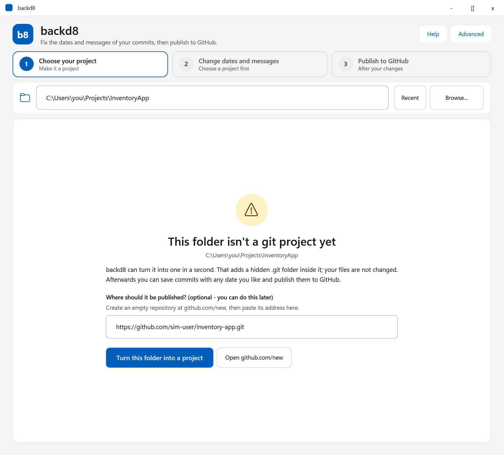
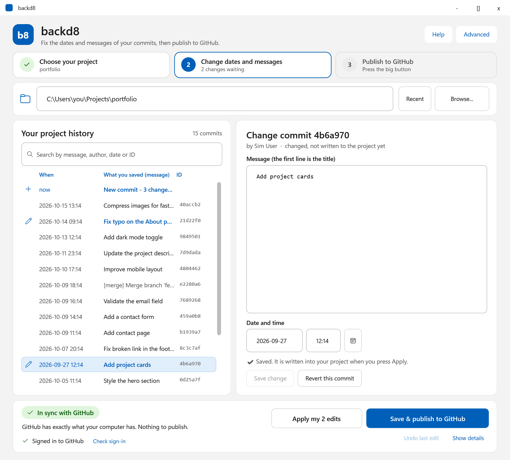
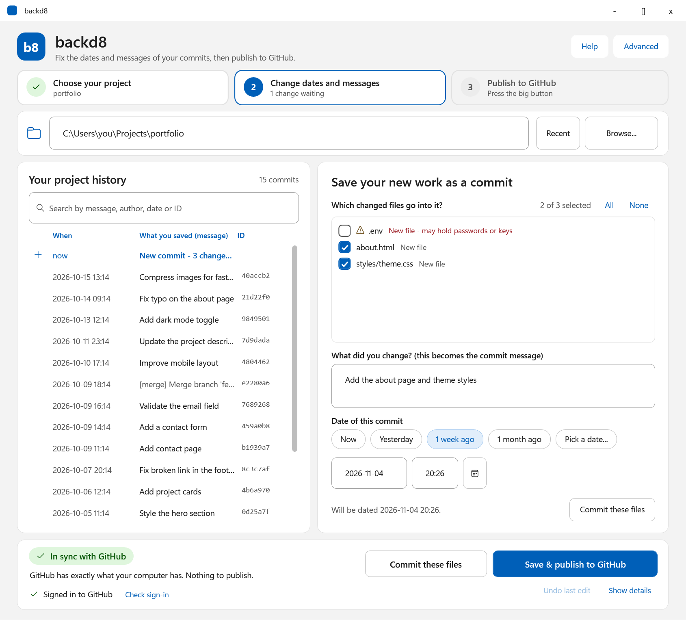
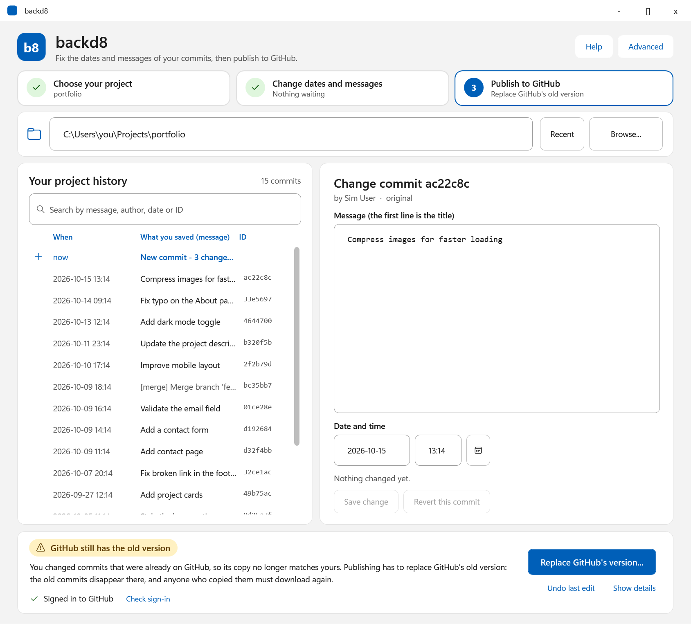

  

  
  
  
  

**backd8** is a small Windows tool for the commit messages and dates of a local project, and for getting it onto GitHub.

> **Choose a folder -> edit the date and message of its commits -> push to GitHub.**

- **Choose any folder.** If it is not a git project yet, backd8 turns it into one and links it to your GitHub repository.
- **Commit your changes** with a message and a date you choose (now, or in the past).
- **Edit older commits**: change their messages and dates, with a backup and one-click undo.
- **Push to GitHub** from the same window. It checks that this PC is signed in and guides you through signing in if it is not.
- Use the **window** (`BackD8.exe`) or the **command line** (`backdate`).

> [!WARNING]
> Editing commits rewrites history; publishing the change needs a force push, and anyone who already pulled the old history must reset or re-clone. Faking commit dates can mislead collaborators; use it only where that is appropriate. (The optional auto-backdating hook, see [Advanced](#advanced-auto-backdate-every-new-commit), is off unless you install it.)

## Screenshots
| Pick a folder, connect it | Edit and publish |
|---|---|
|  |  |
|  |  |

## Requirements
- Windows with Windows PowerShell 5.1 (built into Windows 10/11)
- [Git for Windows](https://git-scm.com/download/win): `winget install --id Git.Git -e` (it also installs Git Credential Manager for GitHub sign-in)

## Quick start
**Window:** run `BackD8.exe` (a small launcher for `gui.ps1`, no console).
1. **Choose your folder** (Browse, paste a path, or drop a folder on the window). A plain folder such as a C# project? Click *Turn this folder into a project* and paste your GitHub repository address (create an empty repo at <https://github.com/new> first).
2. **Write your commit.** Tick the changed files, type the message, pick the date (default: now) and commit. To fix older commits instead, select one, change its message or date, and save the change. To spread several commits over a period, select them and use *Re-date selected commits*.
3. **Publish to GitHub.** If you are not signed in, the button says *Sign in to GitHub* (your browser opens once). If GitHub still has the old version of edited commits, backd8 explains and asks before replacing it.

**Command line:** use `backdate.cmd` in this folder (it starts PowerShell with `-ExecutionPolicy Bypass` for that one process, so it works even though Windows blocks scripts by default). Open a terminal here, or add this folder to your `PATH`. In cmd.exe you can then type just `backdate`; in PowerShell type `backdate.cmd` (PowerShell would pick the blocked `.ps1` first).

    backdate init    C:\Users\you\Projects\portfolio https://github.com/you/portfolio.git
    backdate changes C:\Users\you\Projects\portfolio
    backdate publish C:\Users\you\Projects\portfolio "first version" -Date 2024-03-01T14:30:00

`publish` = commit all changes with your message (and date), then push. Use `commit` to skip the push. Commit with `-Staged` to commit only what you staged yourself.

### Editing older commits
    backdate commits C:\path\to\repo 20
    backdate reword  C:\path\to\repo HEAD~2 "clearer message"
    backdate redate  C:\path\to\repo a1b2c3d 2024-03-01T14:30:00
    backdate push    C:\path\to\repo -Force

`reword` and `redate` (or the window) rewrite the commit you pick **and every commit after it on the current branch**:
- Trees and authors are kept; only the message or date you changed differs. Untouched dates and messages are preserved byte for byte.
- Every descendant gets a new hash, because a hash covers its parents. Tags and other branches still point at the old commits (backd8 lists them).
- GPG/SSH signatures cannot survive a rewrite and are dropped on all rewritten commits. Git notes are carried over.
- Before moving the branch, backd8 saves the old tip as `refs/backd8/backup/<branch>/<timestamp>` (and the new tip as `refs/backd8/rewritten/...`, which `undo` uses to notice later commits). `undo` restores the newest backup for the current branch and refuses if you added commits since (use `-Force` to override; they stay in the reflog). Backups are plain git refs; delete with `git update-ref -d <ref>`.
- Refused when HEAD is detached or a rebase/merge/cherry-pick is in progress. The branch update is compare-and-swap, so a concurrent change aborts the rewrite.
- Commits made by backd8 are never touched by the optional auto-backdate hook.

### Pushing safely
If the old commits were already pushed, the remote has history your branch no longer contains, so a normal push is rejected and `push` refuses with an explanation. `push -Force` first fetches, then uses `--force-with-lease` pinned to what it just saw, so it overwrites the remote only if nobody pushed in between.

**Foreign commits are protected.** If the remote holds commits that exist in none of your branches, tags or backups (for example you pushed from another computer, or amended outside backd8), the force push is refused. Fetch and integrate them, or pass `-DiscardRemote` (the window asks for a second confirmation) if you really mean to delete them.

Commit and publish also refuse to run in the middle of a rebase/merge, and flag files that look like secrets (`.env`, keys, `id_rsa`, ...) so you do not commit them by accident.

## Set up GitHub on a new PC
Pushing needs three things. `backdate github <folder>` (or the window's status line) checks them and prints the fix for whatever is missing:

1. **Git** installed: `winget install --id Git.Git -e`
2. **Your identity**: `git config --global user.name "Your Name"` and `git config --global user.email "you@example.com"`
3. **A GitHub sign-in and a remote.** Create an empty repo at <https://github.com/new>, then `backdate remote <folder> https://github.com/<you>/<repo>.git` (or paste it into the window).

**Sign in** with `github-login <folder>` or the **Sign in to GitHub** button. It opens a console window and does what the remote needs:
- HTTPS remote: a dry-run push, so Git Credential Manager opens your browser. Approve once; Windows remembers it.
- No credential helper but the GitHub CLI is installed: `gh auth login`.
- SSH remote: tests `ssh -T git@github.com` (create a key with `ssh-keygen -t ed25519` and add it at <https://github.com/settings/ssh/new>).

A personal access token (scope `repo`) also works as the password. If a push fails for lack of login, backd8 says "GitHub sign-in required" and the window offers to sign in and retry. Other causes get their own advice: organisation SSO to authorise, an SSH host key problem, "repository not found" (GitHub says this both for missing repos and for missing access), a temporary GitHub error, or no connection.

backd8 never asks for, stores or logs a password or token: git's credential helper does. Background checks set `GIT_TERMINAL_PROMPT=0` so nothing hangs, a push is stopped after 5 minutes, and `user:token@` in remote URLs is masked as `***@`.

## Advanced: auto-backdate every new commit
Optional and off by default. A global `post-commit` hook amends each new commit on this PC so it carries a date you chose, starting at a start date and moving forward 1-6 hours per commit (`backdate install`, `backdate set * 2024-03-01`, `backdate on`).

> [!WARNING]
> **While this is ON, every commit you make on this PC, in every repository, is rewritten with a fake date.** The hook is global (`core.hooksPath`). Turn it OFF (`backdate off`) or remove it (`backdate uninstall`) when you do not want that. You do not need it for the folder -> edit -> push flow above.

`install` does not turn backdating on by itself (a previous ON setting is kept and reported). A repo with no entry uses the default start date and gets its own clock on its first commit. Once the clock catches up with real time, backdating stops for that repo. Start dates must be in the past. A commit is never dated before a backdated parent, so if a repo already has newer commits, the clock effectively starts after them (`set` tells you). The hook is off the fast path when disabled (it checks `config.json` in the shell before starting PowerShell).
## CLI reference
`backdate <command> [args]` (`help` prints the same list; `backdate.cmd` runs `powershell -NoProfile -ExecutionPolicy Bypass -File backdate.ps1`)

| Command | Effect |
|---|---|
| `install [-Force]` | (Advanced) Write the auto-backdate hooks and set the global `core.hooksPath`. Refuses to replace a different existing hooksPath unless `-Force`. |
| `uninstall` | Unset `core.hooksPath` (only if it is ours) and turn backdating OFF. |
| `on` / `off` | Enable / disable backdating. `on` needs a start date. |
| `status` | Hook installed? Backdating on or off? Warns about repos that override `core.hooksPath`. (default command) |
| `list` | Show on/off state, default date and per-repo start / next dates. |
| `set <folder or *> <date>` | Set the start date for a repo folder, or `*` for the default. Resets that repo's clock. |
| `remove <folder>` | Forget a repo's entry (it then follows the default). |
| `init <folder> [github-url]` | Turn a plain folder into a git project (branch `main`) and optionally link it to GitHub. |
| `remote <folder> <github-url>` | Link (or re-link) the project to its GitHub repository. |
| `changes <folder>` | List files changed since the last commit (flags secret-looking files). |
| `commit <folder> <message> [-Staged] [-Date <date>] [-IncludeRisky]` | Commit all changes (or only staged ones) with your message and optional past date. `-MessageFile <file>` for multi-line messages. Files that look like secrets (`.env`, keys, `appsettings.json`, passwords in config files) are refused unless you add `-IncludeRisky`. |
| `publish <folder> <message> [-Date <date>] [-Force]` | Commit all changes (if there are any), then push, in one step. `-MessageFile <file>` works too. After `reword`/`redate` use `push <folder> -Force`. |
| `commits <folder> [count]` | List recent commits (default 20): short hash, date, subject. |
| `reword <folder> <sha> <message>` | Change a commit message. `<sha>` can be a short/full sha, `HEAD~2`, a branch or a tag. Use `-MessageFile <file>` for multi-line messages, quotes or a leading `-`. |
| `redate <folder> <sha> <date>` | Change a commit's author and committer date. Date must be in the past. |
| `undo <folder> [-Force]` | Undo the most recent reword/redate on the current branch. |
| `push <folder> [-Force] [-DiscardRemote]` | Push the current branch to its remote (`origin` if none is configured). |
| `sync <folder>` | Get newer changes from GitHub (fast-forward, or merge when both sides changed; never rewrites your commits; on a conflict nothing is changed). |
| `ignore <folder> [dotnet\|node\|python\|java\|generic]` | Add a `.gitignore` so build and editor files are not committed. |
| `account <folder> [name]` | Show, or choose, which saved GitHub account this project uses. Needed when several accounts are saved on the PC and the address does not name one (otherwise checks can say "not signed in" even though you are). backd8 picks the account that owns the repository automatically. |
| `github <folder>` | Check this PC can push: git identity, remote, saved sign-in, dry-run push. Prints what to do if not. |
| `github-login <folder>` | Sign in to GitHub (see above). |
| `help` | Print usage. |

Dates: `2024-03-01` or `2024-03-01T14:30:00`, local time (`01/03/2024` is rejected as ambiguous). The hook leaves alone commits that already carry a date older than one day (set by hand), merge commits, rebases, cherry-picks and partial commits (other changes still staged).

The window also offers things without a command: the file checklist with secret and build-file warnings, date presets, re-dating several commits at once, a recent-folders list and sign-in with a browser. Everything else (commit, edit, undo, publish, sync, sign-in) exists in both.

## Known limits
- A repo-local `core.hooksPath` overrides the global one, so hook backdating does nothing there (`status` warns; reword/redate/push still work).
- Installed hooks forward to the repo's own `.git/hooks/<name>` so those keep working.
- Hooks call this folder's `backdate.ps1` on every commit. Run `uninstall` BEFORE moving or deleting the folder: a hooksPath pointing at a missing folder makes git ignore every repository's own hooks too (`status` warns about it). After a move, run `install` from the new location (it recognises the old copy; no `-Force` needed). Keep the folder somewhere only you can write to.
- A quoted path ending in a backslash (`"C:\repo\"`) is mangled by PowerShell argument parsing; omit the trailing `\`.
- The hook and `BackD8.exe` start PowerShell with `-ExecutionPolicy Bypass` for that process only; your machine policy is not changed.
- Settings live in `config.json` inside this folder (repo paths stored lowercased with `/`; git-ignored). Deleting the folder deletes the settings.
- The hook prints nothing on success, only warnings, so scripts that treat git's stderr as an error are not disturbed.
- If `BackD8.exe` shows nothing, run `powershell -STA -File gui.ps1` to see errors.

## Troubleshooting
- **"... cannot be loaded because running scripts is disabled on this system"**, or "not digitally signed": use `backdate.cmd` (and `BackD8.exe` for the window), which start PowerShell with `-ExecutionPolicy Bypass` for that one process. Files from a downloaded zip are also marked as blocked: right-click the zip > Properties > Unblock before extracting, or run `Get-ChildItem -Recurse | Unblock-File` in the folder.
- **The window does not appear:** run `powershell -STA -ExecutionPolicy Bypass -File gui.ps1` in a terminal to see the error. Crashes are also written to `%TEMP%\backd8-error.log`.
- **GitHub says you are not signed in although you are:** with several saved GitHub accounts, run `backdate account <folder>` to see which one the project uses.

## Uninstall / cleanup
    backdate uninstall

Then delete the folder. This does not change any commits already made. Leftover `refs/backd8/...` refs stay in the repos you edited (`git for-each-ref refs/backd8`).

## How the workflow is built
The window and the `state` command are views of one deterministic finite state machine (`workflow.ps1`). Facts about the project (is it a git project, trusted, has changes, ahead/behind GitHub, signed in, ...) resolve to exactly one of 24 named states; each state offers a fixed list of actions, each guarded by prerequisites that explain themselves when not met (`backdate state <folder>` shows them). Every action re-checks its state before it runs and re-derives the state afterwards, so a failure always lands somewhere with a way forward. `backdate state-model` (and `tests\uat-workflow.ps1`) prove, over thousands of fact combinations, that the model is deterministic and total, has no dead ends, and that every state can reach "everything is saved and published".

## Development
`powershell -ExecutionPolicy Bypass -File build.ps1 [-Out <exe path>]` rebuilds `BackD8.exe` from `BackD8.cs` with the .NET Framework `csc.exe` that ships with Windows (no SDK). `powershell -ExecutionPolicy Bypass -File docs\make-assets.ps1` regenerates the logo and banner.

Tests use temporary folders, a private git config (`GIT_CONFIG_GLOBAL`) and `BACKDATE_CONFIG`, so your real settings are untouched:

    powershell -ExecutionPolicy Bypass -File tests\uat.ps1        # backdating, hook, window self-test
    powershell -ExecutionPolicy Bypass -File tests\uat-repo.ps1   # commit editing, push, GitHub checks
    powershell -ExecutionPolicy Bypass -File tests\uat-workflow.ps1   # the workflow state machine: formal proof + every state with real repositories
    powershell -ExecutionPolicy Bypass -File tests\simulate.ps1   # end-to-end story against a fake GitHub

`uat.ps1` briefly starts the window (`BackD8.exe`), so one may flash on screen.

`tests\simulate.ps1` plays a full story against `tests\fake-github.ps1`, a real smart-HTTP git server that requires a login: new PC without identity, backdated commits, push refused until "signed in", edits, force push, a second computer, undo, uninstall. No internet is used. Test files contain non-ASCII text and must stay UTF-8 with BOM. See [CONTRIBUTING.md](CONTRIBUTING.md) and [SECURITY.md](SECURITY.md).

## License
[MIT](LICENSE)
